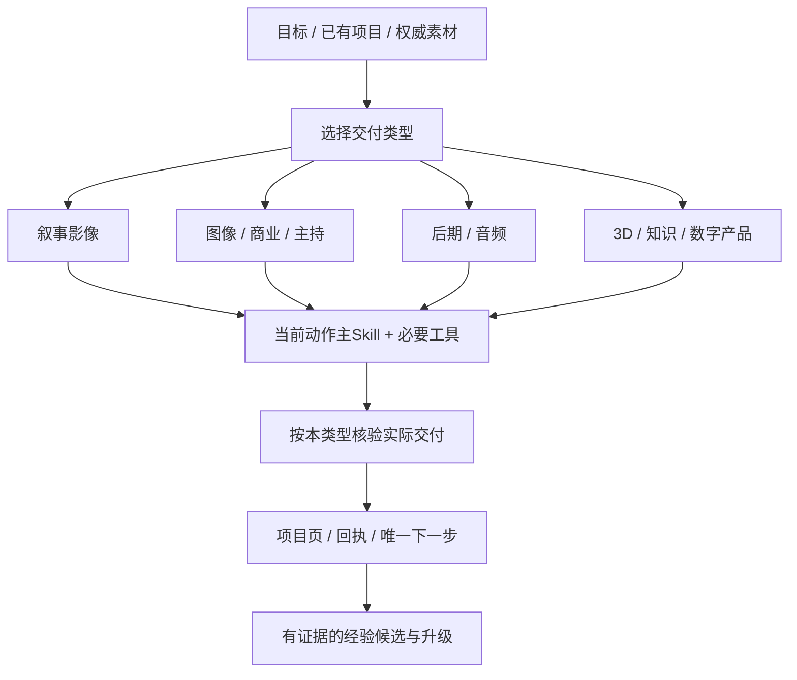

# AIGC

个人 AIGC 专业制作与 Skill 工作流。适用于 Windows 与 macOS，提供跨类型路由、17个本地Skill、专业知识、项目模板、安装/升级/回滚工具，以及按生产类型分别验收的标准。

版本：**1.0.0**。仓库仅包含工作方法与代码；个人记忆、项目素材、密钥、模型和外部插件账号独立维护。

## 从这里开始

| 需要做什么 | 文档 |
|---|---|
| 新电脑安装 | [安装与首次运行](docs/INSTALL.md) |
| Windows / macOS差异 | [平台兼容与依赖](docs/PLATFORMS.md) |
| 完整专业制作流程 | [生产工作流](docs/WORKFLOW.md) |
| 17个Skill与职责 | [Skill目录](docs/SKILLS.md) |
| 外部服务与可选插件 | [集成与能力检查](docs/INTEGRATIONS.md) |
| 日常更新、备份、回滚 | [升级维护](docs/UPGRADE.md) |
| 文件、资产、回执与记忆 | [项目与资产合同](docs/PROJECTS.md) |
| 运行验证与CI | [验证说明](docs/TESTING.md) |

## 快速安装

需要 Git 和 Python 3.10+。安装/路由/状态工具仅依赖标准库；Windows的时区数据通过自带固定UTC+8回退处理，媒体分析依赖另装。

macOS终端：

```bash
gh repo clone cyou1314/AIGC
cd AIGC
python3 scripts/manage.py install --workspace "$HOME/AIGC-workspace"
python3 scripts/doctor.py
python3 scripts/validate.py
```

Windows PowerShell：

```powershell
gh repo clone cyou1314/AIGC
Set-Location AIGC
py -3 scripts/manage.py install --workspace "$env:USERPROFILE\AIGC-workspace"
py -3 scripts/doctor.py
py -3 scripts/validate.py
```

也可以用已认证的 `git clone https://github.com/cyou1314/AIGC.git`。私有仓库需要账号访问权限；仓库地址不是访问凭证。

已有Skill冲突时，安装器停止并列出冲突。选择使用已有版本，或确认备份后用 `--adopt-existing` 纳入本仓库管理。已托管Skill的本地修改同样不会静默覆盖。

## 使用方法

在安装后的Codex会话中直接描述目标或显式使用 `$aigc-production-router`：

```text
开始：制作9:16短剧，先检查这份剧本，再做分镜。
制作4:5商品海报，保留标签文字，交付PNG。
制作20秒商品开箱UGC，先只给脚本。
把这段原始口播保守粗剪成MP4，保留原声。
制作15秒紧张氛围配乐，交付WAV。
生成用于游戏导入的GLB角色，先确认目标引擎。
把提供的资料做成可编辑PPT。
在已有仓库中实现AI工具，服从当前技术栈。
```

每次选择一个当前动作的主Skill。不同类型有自己的完成标准；提示词、实际生成、文件可读、质量核验和用户接受分别登记。



## 仓库结构

```text
skills/                 17个本地Skill及脚本、参考、测试
knowledge/              可移植职业知识与工作流
templates/              快速/完整项目页与交接合同
docs/                   专业工作流与操作手册
scripts/                跨平台安装、检查、验证与维护
tests/                  安装、升级、回滚与状态回归
ci/                     Windows/macOS CI配置模板
VERSION + CHANGELOG.md  版本与升级记录
```

## 验证范围

本仓库的本地工具可独立检查目录、路径、安装冲突、状态和回执。17个Skill存在不表示所有生成服务已登录；Windows CI模板不表示已经在Windows运行。实际影片、图像、音频、模型、文档和应用按项目各自验证。付费生成和发布遵循本次任务授权与预算。

外部Codex插件（Kling、Meshy、Higgsfield、Adobe、Sites等）按需单独安装/连接，参考 [INTEGRATIONS](docs/INTEGRATIONS.md)。自动剪辑、转录与其他第三方代码保留原许可证，详见 [THIRD_PARTY_NOTICES](THIRD_PARTY_NOTICES.md)。
